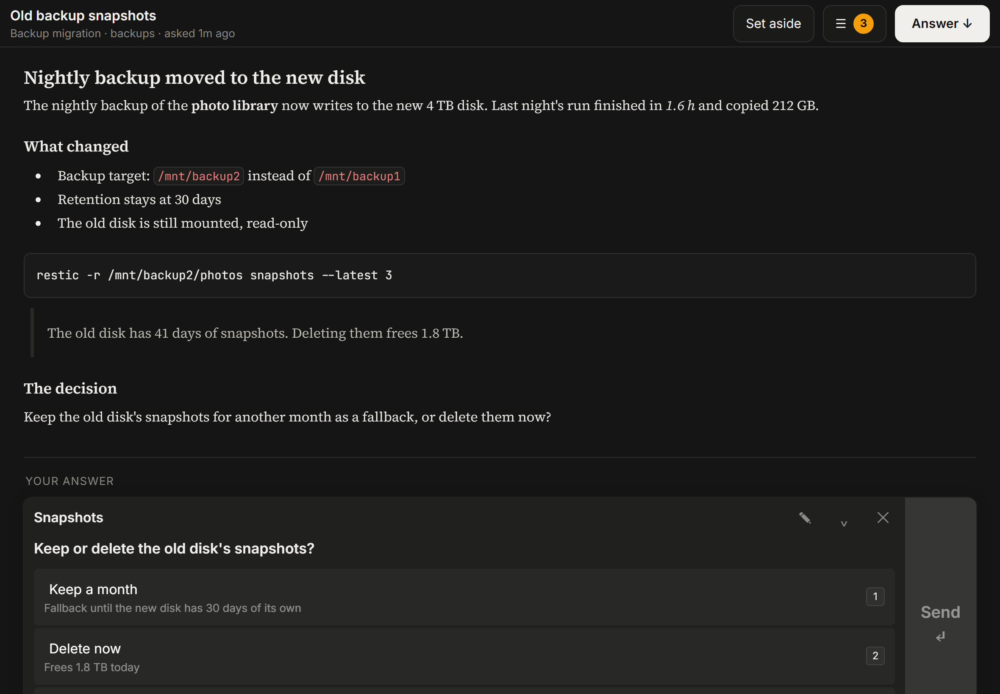

# aqua: Agent Questions & User Answers

An inbox for the questions your coding agents ask you. An agent sends a question together with everything you need
to answer it: findings, tables, links, plots. You read it on a full page, in the browser or on a tablet, pick an
option or type your own answer, and the agent picks up the answer and carries on.

It replaces the one-line question at the end of a chat. Several agents can ask at once; their questions wait in one
list, and each stays open until you answer it, even when the agent's chat has moved on.



*A made-up example question.*

- **Server**: a small FastAPI app with SQLite storage. One process, one data folder.
- **Agents ask** through a command-line tool (standard-library Python, runs anywhere) or an MCP server with
  `ask_user`, `wait_for_answer`, `check_answer` and `withdraw_question` tools.
- **The page** renders the context as Markdown with images, works with touch, and installs as a home-screen web app
  on an iPad or phone.

## Install

Requires Python 3.10 or newer and [uv](https://docs.astral.sh/uv/).

```bash
uv tool install "aqua[server,mcp] @ git+https://github.com/kevinwwillis/aqua"
```

This installs three commands: `aqua-server`, `aqua` (the agents' CLI) and `aqua-mcp` (the MCP server).

## Run the server

```bash
AQUA_DATA=~/aqua-data aqua-server
```

Then open <http://127.0.0.1:18451>. Questions and uploaded images are stored in `AQUA_DATA`.

| Variable | Default | Meaning |
|---|---|---|
| `AQUA_DATA` | `data` (in the current folder) | Folder for the database and uploaded media |
| `AQUA_HOST` | `127.0.0.1` | Address to listen on |
| `AQUA_PORT` | `18451` | Port |
| `AQUA_TOKEN` | unset | Access token; see [Security](#security) |
| `AQUA_ALLOWED_HOSTS` | local names (any name when a token is set) | Comma-separated host names the server answers to |

## Ask from an agent

```bash
aqua ask --title "Old backup snapshots" --context-file context.md \
  --question "Keep or delete the old disk's snapshots?" \
  --option "Keep a month::Fallback until the new disk has 30 days of its own" \
  --option "Delete now::Frees 1.8 TB today"
```

- `--title`: a few words; it is the line shown in the inbox list.
- `--context-file`: Markdown read before answering. Local files it links (``) are uploaded: PNG,
  JPEG, GIF, WebP, MP4, WebM and PDF, up to 50 MB each. SVG is refused (an SVG can carry scripts).
- Questions as flags (`--header`, `--question`, `--option "Label::description"`, `--multi`, repeated per
  question), or as JSON with `--questions-file`: `[{"header": "...", "question": "...?", "options":
  [{"label": "...", "description": "..."}], "multiSelect": false}]`. Up to 8 questions per ask; the person
  answering can always type their own answer and add a note.
- By default `aqua ask` waits and prints the answer. `--no-wait` prints the question id and returns; then
  `aqua answer <id>` (exit code 3 while it is still waiting), `aqua answer <id> --wait`, or `aqua withdraw <id>`.

Tell your agents to use it, for example in `CLAUDE.md` or `AGENTS.md`: "Ask me every question through aqua: write
everything I need to answer into a context file and run `aqua ask` in the background."

### Agent settings

The CLI and the MCP server read `~/.config/aqua/config.json`; a non-empty environment variable wins over it.

```json
{"url": "http://127.0.0.1:18451", "user_name": "Ada", "token": ""}
```

| Setting | Variable | Meaning |
|---|---|---|
| `url` | `AQUA_URL` | The server's address |
| `user_name` | `AQUA_USER_NAME` | What agents call you ("Asked Ada: question ..."). Also adds an `ask_ada` MCP tool. |
| `token` | `AQUA_TOKEN` | The server's access token, if it has one |
| | `AQUA_SESSION_NAME` | The asking session's name, shown with its questions |

### MCP

```bash
claude mcp add --scope user aqua -- aqua-mcp
```

For Codex, in `~/.codex/config.toml` (a blocking ask waits up to 9 minutes per call, so raise the tool timeout):

```toml
[mcp_servers.aqua]
command = "aqua-mcp"
tool_timeout_sec = 600
```

A blocking `ask_user` waits up to 9 minutes; if there is no answer by then it returns "still waiting" with the id,
and the agent calls `wait_for_answer` to keep waiting.

## Use it from a tablet or phone

Serve it over a private network such as [Tailscale](https://tailscale.com) so other devices can reach it, for example
`tailscale serve --bg --https=8460 http://127.0.0.1:18451`. Add that name to the server's allowed hosts
(`AQUA_ALLOWED_HOSTS=my-machine.example.ts.net,127.0.0.1,localhost`) and point every agent's `url` at that address. On
an iPad, open the page in Safari and use Share > Add to Home Screen.

## Security

Without `AQUA_TOKEN`, anyone who can reach the server can read every question and answer them. Keep it on
`127.0.0.1` or a private network. If others can reach it, set `AQUA_TOKEN` to a long random string: agents send it
from their settings, and each browser opens the page once at `<address>/#token=<the token>`. The part after `#`
is not part of the page request, so it stays out of server and proxy logs; the page sends the token once in the body
of a login request, gets a cookie, and removes it from the address. Use HTTPS so the token is not sent in the clear.

The server only answers to the host names in `AQUA_ALLOWED_HOSTS` (by default the local names, or any name once a
token is set), so a website cannot reach a server on your machine by pointing its own domain at `127.0.0.1`.

What else to know:

- **What an ask sends.** Besides the question and context, each ask sends the agent's project folder path, the
  machine's hostname, the session name and, under Claude Code, its session id. They are stored with the question and
  shown in the inbox. Keep that in mind before pointing agents at a server someone else runs.
- **Images in the context.** Local images are uploaded to the server. Images linked from other sites (``)
  load from those sites when the question is opened, which tells them the reader's IP address and when it was read.
- **The page renders agent-written Markdown** through a sanitizer (DOMPurify); scripts and raw HTML event handlers
  are removed.

## Development

```bash
uv run --extra server --extra mcp pytest -q
AQUA_DATA=/tmp/aqua uv run --extra server aqua-server
```

## License

MIT, see [LICENSE](LICENSE). Bundled libraries and fonts keep their own licenses; see
[THIRD_PARTY_NOTICES.md](THIRD_PARTY_NOTICES.md).
